# Ip address validator

**Name:** Josh williams 

**Campus:** NCL motherwell

**Banner id:** B01888344

## what the program does
the program asks the user for an ip address and check if it is a correctly formated ipv4 address it will print valid ip address and if not it prints invalid ip address 

an address is valid when it has:
- exactly four parts seprated by dots 
- digits only in every part
- every part between 0 and 255

## requirements
- python 3.x
- standard libary only so nothing needs installing 

## how to run
1. close the repo and switch to this branch:
```bash
git clone git clone https://github.com/YOURUSERNAME/prog-for-cybercw1.git
cd prog-for-cybercw1
git switch ip-address-validator
```
2. run the program
```bash
python IpAddressValidator.py
```
3. type an ip address when prompted

## example 
```
enter an ip address: 192.168.1.1
valid ip address
```
```
enter an ip address: 256.1.1.1
invalid ip address
```

## assumption and error handling
- only format is checked the program does not check if the address exists or can be reached
- spaces at the start or end of the input are removed before checking
- empty input letters symbols negative numbers and empty parts are all reporrted as invalid 
- only ascii digits are accepted which stops unusual character such as ² from crashing the program
- leading zeros  are accepted beacuse each part is still a number from 0 255
- try except around main() catches ctrl+c and an early end of input so the program exits cleanly

## testing evidence 

| # | Input | Expected result |
|---|-------|-----------------|
| A1 | 192.168.1.1 | Valid IP address |
| A2 | 0.0.0.0 | Valid IP address |
| A3 | 255.255.255.255 | Valid IP address |
| A4 |  192.168.1.1  spaces around it | Valid IP address |
| B1 | 256.1.1.1 | Invalid IP address part above 255 |
| B2 | 192.168.1 | Invalid IP address only three parts |
| B3 | 192.168.1.1.1 | Invalid IP address five parts |
| B4 | 192.168..1 | Invalid IP address empty part |
| B5 | abc.def.ghi.jkl | Invalid IP address (letters) |
| B6 | -1.2.3.4 | Invalid IP address (negative number) |
| B7 | 1.2.3.² | Invalid IP address, no crash |
| B8 | Press Enter with nothing typed | Invalid IP address |
| C1 | Press Ctrl+C at the prompt | "Program interrupted. Exiting", no traceback |


### screenshots 

**A1: normal address**

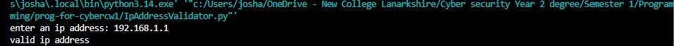

**A2: lowest address**

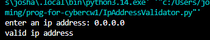

**A3: highest address**

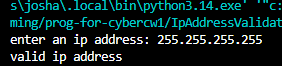

**A4: spaces around the address**

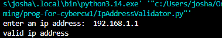

**B1: part above 255**

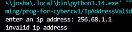

**B2: three parts**

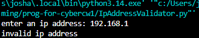

**B3: fives parts**

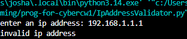

**B4: empty part**

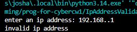

**B5: letters**

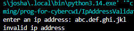

**B6: negative number**

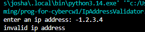

**B7: unusual character**

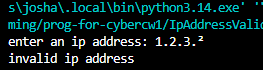

**B8: nothing typed**

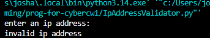

**C1: ctrl+c**

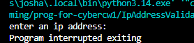