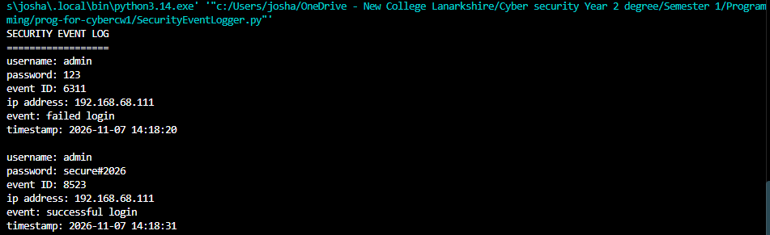
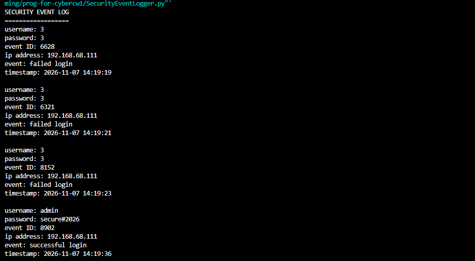
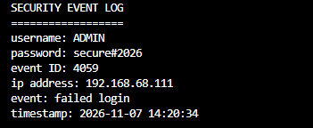
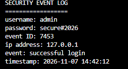
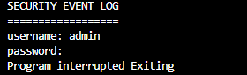

# Task 2: security event logger 

**Name:** Josh williams

**Campus:** NCL motherwell

**Banner id:** B01888344

## what the program does
the program asks for a username and password and keeps asking until the login works correctly every attempt regardless if it works or no is logged with:

- a random 4 digit **event id**
- the **username** entered
- the **ip address** of the computer
- the **event** failed or successful login
- a **timestamp** date and time of attempt

the program ends once a login works

## requirements
- python 3.x
- standard libary only so nothing needs installing 

## how to run 
1. clone the repo and switch to this branch: 
```bash
git clone https://github.com/YOURUSERNAME/prog-for-cybercw1.git
cd prog-for-cybercw1
git switch security-event-logger
```
2. run the program:
```bash
python SecurityEventLogger
```
3. enter the demo username and password when prompted 

username = "admin"

password = "secure#2026"


## example output
```
SECURITY EVENT LOG
==================
username: admin
password: wrongpass
event id :4821
ip address: 192.168.99.99
event: failed login
timestamp: 2026-11-07 14:32:10
```

the ip address and event id will differ depending on the machine 

## assumptions and error handling
- the loging details can be changed and are temp values
- the username and password checks are case sensitve
- wrong or empty inputs are logged as a failed login
- the ip address is looked up once at the start beacuse it does not change while the program runs 
- if there is no netowrk get_myip() catches the OSerror uses 127.0.0.1
- try-except around main() catches  ctrl+c and an early end of input so the program exits cleanly
- the event id is random so two entries could share the same number in theory
- there is no limit on failed attempts as the program is designed to keep logging until crednetials are guessed or inputted correctly 

## testing evidence 

| # | Input | Expected result |
|---|-------|-----------------|
| A1 | Correct username and password | One Successful login entry program ends |
| A2 | Wrong password then correct details | Failed login entry then Successful login program ends |
| A3 | Wrong details 3 times then correct | Three Failed login entries, then Successful login |
| A4 | Username in capitals | Logged as Failed login case-sensitive |
| A5 | Press Enter on both prompts | Logged as Failed login with an empty username |
| A6 | No network route (simulated by temporarily using an invalid address in `get_my_ip()`) | IP address shows `127.0.0.1` |
| A7 | Press Ctrl+C at a prompt | Program interrupted. Exiting, no traceback |

### screenshots

**A1: valid login**


**A2: wrong password then correct details**



**A3: three failures then working**



**A4: username in capitals**



**A5: empty input**


**A6: no network connection**



**A7: ctrl+c**



