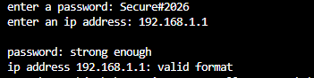
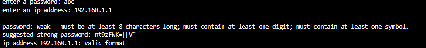
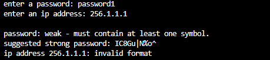
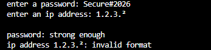
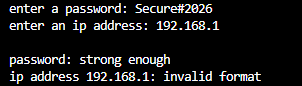
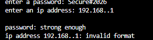
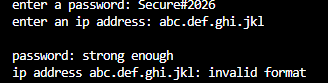
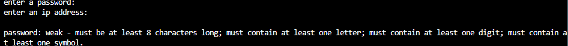
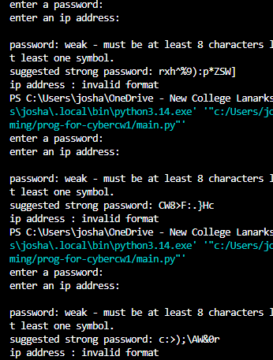
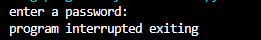

# Reusable cyber security utilities

**name:** josh williams 

**campus:** NCL motherwell

**banner id:** b01888344

## what the program does
the code is split between two files: 

- **SecurityTools.py** is a module of reuable functions:
- checks a password for length and variety
- checks the format of an ipv4 address
- generates a strong rnadom password
- **main.py** imports the module asks the user for a password and a ip address and then shows it saying if the passwords is weak what it's missing and suggesting a randomly generated one

## requirments
- python 3.x
- standard libary only so nothing else needs installing
- both files must be in the same folder (this will break it pls don't)


## how to run 
1. clone the repo and switch to this branch:
```bash
git clone git clone https://github.com/YOURUSERNAME/prog-for-cybercw1.git
cd prog-for-cybercw1
git switch cyber-security-utilities
```
2. run the program:
```bash
python main.py
```
3 enter a password and an ip address when prompted

## example output
```
enter a password: abc
enter an IP address: 192.168.1.1

password: weak must be at least 8 characters long must contain at least one digit must contain at least one symbol.
Suggested strong password: k#7Qm!x2Lp9
IP address 192.168.1.1: valid format
```
the suggested password changes every time

## assumptions and error handling 
- a valid password has at least 8 character one letter one digit and one symbol the brief does not give a length so 8 is assumed
- a symbol is any character in pythons string.puncuation
- only the format of the ip address is check not if it exists or reachable
- only ascci digits are accepted in an ip address which stops weird characters such as ² from crashing the program
- spaces around the ip address are remove before it is checked
- the generated password uses the secrets module which is designed for security its length is chosen randomly from 10 to 16 and it always will have a uppercase and lowercase and a digit and symbol
- try except and main() catches ctrl+c and an early end of input so the program exits cleanly


## Testing evidence

| # | Password / IP entered | Expected result |
|---|-----------------------|-----------------|
| A1 | Secure#2026 / 192.168.1.1 | Password strong ip valid |
| A2 | abc / 192.168.1.1 | weak with all four problems listed suggested password shown, ip valid |
| A3 | password1 / 256.1.1.1 | weak no symbol suggested password shown, ip invalid |
| A4 | Secure#2026 / 1.2.3.² | Password strong ip invalid no crash |
| B1 | Secure#2026 / 192.168.1 | ip invalid three parts |
| B2 | Secure#2026 / 192.168..1 | ip invalid empty part |
| B3 | Secure#2026 / abc.def.ghi.jkl | ip invalid letters |
| B4 | Press Enter on both prompts | Password weak with all four problems, ip invalid |
| C1 | Run the program with a weak password three times | Three different suggested passwords each 10 to 16 characters |
| D1 | Press Ctrl+C at a prompt | Program interrupted. Exiting no traceback |

### screenshots

**A1: strong password valid ip**



**A2: weak passwords with suggestion**



**A3: weak passwords ip above 255**



**A4: unusual characters in ip**



**B1: three part ip**



**B2: empty part in ip**



**B3: letters in ip** 



**B4: empty input**



**C1: genreated passwords differ each run**



**D1: ctrl+c**

