# Task 2: security tool

**Name:** Josh williams 

**Campus:** NCL motherwell

**Banner ID:** B0188344


## what the program does
It's a menu driven security tool written within python the user must log in first and 3 failed attempts results in a locked account once you're logged in the menu offers:

1. **Security event counter** the user can enter a password up to 10 times the program counts correct and failed entries and shows the percentage of the incorrect attempts and raises an alert if more than 50 percent were wrong

2. **brute force simulator** the user has up to 5 tries to guess a set password the program reports if you got it right or you ran our of attempts 

3. **login** repates the login check if it fails 3 times then the account is frozen and the program ends

4. **exit** Closes the program


## requirements
- python 3.x (no other libraries needed) 

## how to run
1. clone the repo and switch to this branch:
``` bash
git clone https://github.com/YOURUSERNAME/prog-for-cybercw1.git
cd prog-for-cyber-cw1
git switch SecurityTool
```
2 Run the program:
``` bash
python SecurityTool.py
```
log in when prompted then pick an option from the menu

## example 
**input** a valid username and password then menu option `1` then 10 password entries some right some wrong

**output**
```
correct passwords: 4
inoccrect passwords:6
percentage incorrect 60.0%
Alert: more than 50 percent of the passwords entered were incorrect
```
Username = Admin

Password = Secure123

## input validation and error handling

- wrong login derails are counted and the account is frozen after 3 wrong attempts

- an invalid menu choice shows an error message and the menu is displayed again

- division by zero is prevented in the percentage calc 

- whitespace around the menu choice is removed so a stray space is not treated as invalid

- `try except` catches ctrl+c and end of input so the program exits cleanly instead of crashing

## testing evidence 

### A. Startup login
| # | input | expected result | 
|---|-------|-----------------|
| A1 | Valid username and password | login successfulm then the menu appears |
| A2 | Wrong password, then correct details | Failed tries 1 of 3 then login succeeds |
| A3 | Wrong details 3 times | Account is frozen for 24 hours program ends no menu shown |
| A4 | Username in lowercase | Fails because the name check is case-sensitive |
| A5 | Press Enter on both prompts | Counts as a failed try |

### B. menu

| # | Input | Expected result |
|---|-------|-----------------|
| B1 | 9 | Invalid choice message, menu shown again |
| B2 | abc | "Invalid choice" message, menu shown again |
| B3 | Press Enter with nothing typed | Invalid choice message |
| B4 |  2  (spaces around it) | Treated as option 2, thanks to `.strip()` |
| B5 | 4 | Thank you for using the security tool, program ends |

### C. Security event counter

| # | Passwords entered | Expected result |
|---|-------------------|-----------------|
| C1 | All 10 correct | 10 correct, 0 incorrect, 0.0%, no alert |
| C2 | 8 correct, 2 wrong | 8 correct, 2 incorrect, 20.0%, no alert |
| C3 | 5 correct, 5 wrong | 5 correct, 5 incorrect, 50.0%, no alert (boundary test) |
| C4 | 4 correct, 6 wrong | 4 correct, 6 incorrect, 60.0%, ALERT shown |
| C5 | All 10 wrong | 0 correct, 10 incorrect, 100.0%, ALERT shown |

The alert only appears when more than 50% of the entries are wrong so with 10 attempts it fires at 6 or more wrong 50 percent it self does not activate it

### D. Brute force simulator 

| # | Guesses | Expected result |
|---|---------|-----------------|
| D1 | Correct on try 1 | "Password guessed in 1 try/tries", returns to the menu |
| D2 | 2 wrong, then correct | "Password guessed in 3 try/tries" |
| D3 | 5 wrong | "Maximum tries (5) reached. Password not guessed" 

### E. login from menu 

| # | Input | Expected result |
|---|-------|-----------------|
| E1 | Correct details | "Login successful", returns to the menu with no "invalid choice" message |
| E2 | Wrong details 3 times | "Account is frozen", program ends |

### F. interruption

| # | Action | Expected result |
|---|--------|-----------------|
| F1 | Press Ctrl+C at any prompt | "Program interrupted. Exiting", with no traceback |

## Screenshots

### Start up login

**A1: valid login**

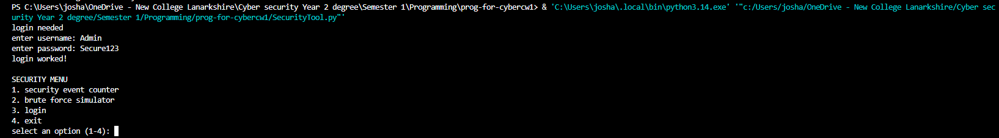 

**A2: Wrong password then correct details** 

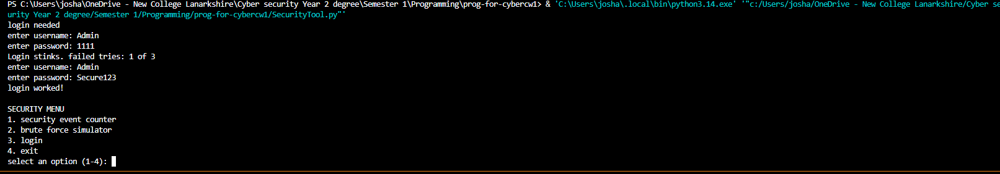

**A3: Wrong details 3 times**

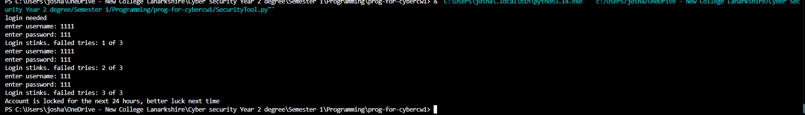

**A4: username in lowercase**

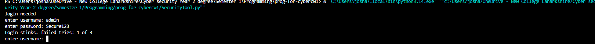

**A5: Press enter on both prompt** 

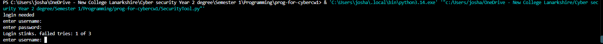

### B. Menu

**B1: Menu Choice 9**

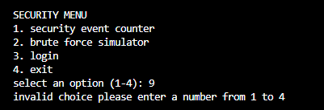

**B2: menu choice ABC**


**B3: nothing typed**

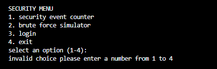

**B4: Spaces around the choice**

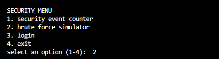

**B5: Exit with 4**

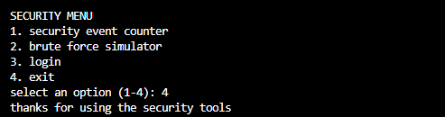

### C security event counter

**C1: all 10 correct**

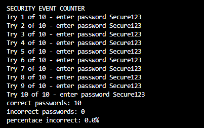

**C2: 8 correct 2 wrong**

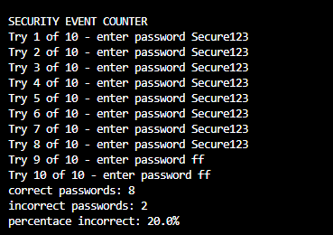

**C3: 5 correct 5 wrong**

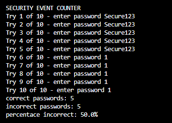

**C4: 4 correct 6 wrong**

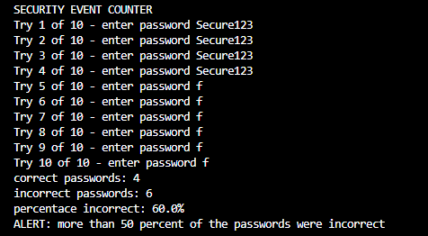

**C5: all 10 wrong**

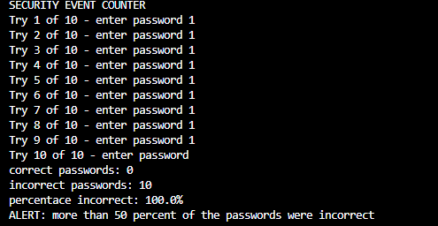

### D. Brute force simulator

**D1: correct on try 1**

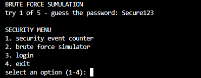

**D2: 2 wrong, then correct**

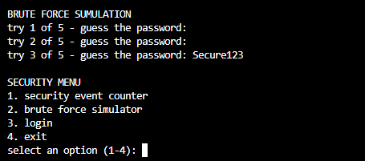

**D3: 5 wrong guesses**

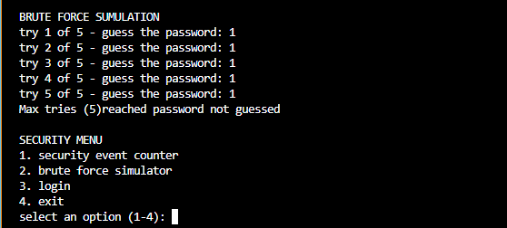

### E. login from the menu 

**E1 Correct details** 

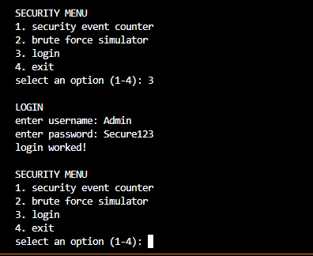

**E2 Wrong details 3 times**

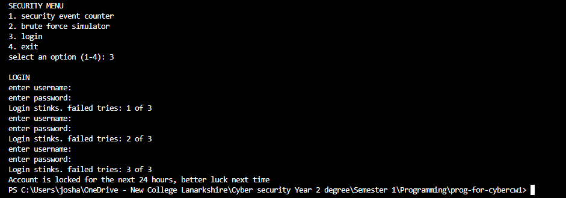

### F. interruption

**F1: ctrl+c at a prompt**

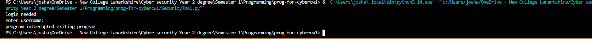