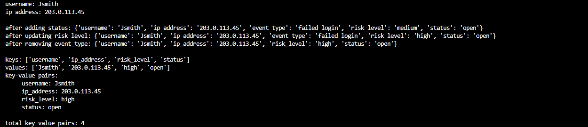
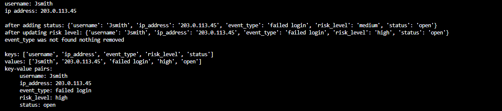

# Security incident manager

**name:** josh williams

**campus:** NCL motherwell

**banner id:** B01888344

## what the program does
the program stores one security incident in a python dictionary and then updates it step by step:

1. creates the incident with a username ip address event type and risk level
2. displays the username and ip address
3. adds a new fields called status
4. updates the risk level
5. removes one fields event_type
6. displays all the remaining keys and values
7. displays the total number of key value pairs

## requirements
- python 3.x
- standard libary only so nothing needs installing

## how to run

1. clone the repo and switch  to this branch:
```bash
git clone git clone https://github.com/YOURNAME/prog-for-cybercw1.git
cd prog-for-cybercw1
git switch security-incident-manager
```
2 run the program
```bash
python SecurityIncidentManager.py
```
3 the program needs no input and prints the results straight away

## example output
```
SECURITY INCIDENT MANAGER
=========================
Username: jsmith
IP address: 192.168.1.25

Added the status field
Updated risk_level to high
Removed the event_type field

Remaining incident details:
username: jsmith
ip_address: 192.168.1.25
risk_level: high
status: open

Total key-value pairs: 4
```

## assumptions and error handling
- the incident details are example values stored in the code.
- the program take no user input so there is no input to validate
- try except in remove field() catches a keyerror if the field does no exist and the program reports that nothing was removed
- try except around main() catches ctrl+c so the program exists cleanly
= assigning to an existing key risk_level replaces it's vlaue while assigning to a new key status adds is

## testing evidence 

| # | Test | Expected result |
|---|------|-----------------|
| A1 | Run the program | Username and IP address are displayed |
| A2 | Run the program | `status` is added and shown as `open` |
| A3 | Run the program | `risk_level` changes from `medium` to `high` |
| A4 | Run the program | `event_type` is removed and no longer listed |
| A5 | Run the program | 4 remaining pairs are listed and the total shows 4 |
| B1 | Change the field name in `remove_field(incident, "event_type")` to `"missing"` | "event_type was not found" style message, no crash, total shows 5 |


### screenshots

**A1 - A5: full normal run** 



**B1: removing a field that does not exist**

